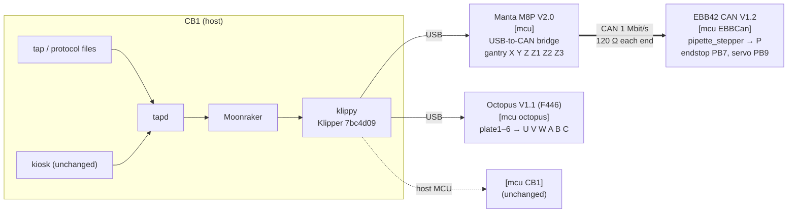
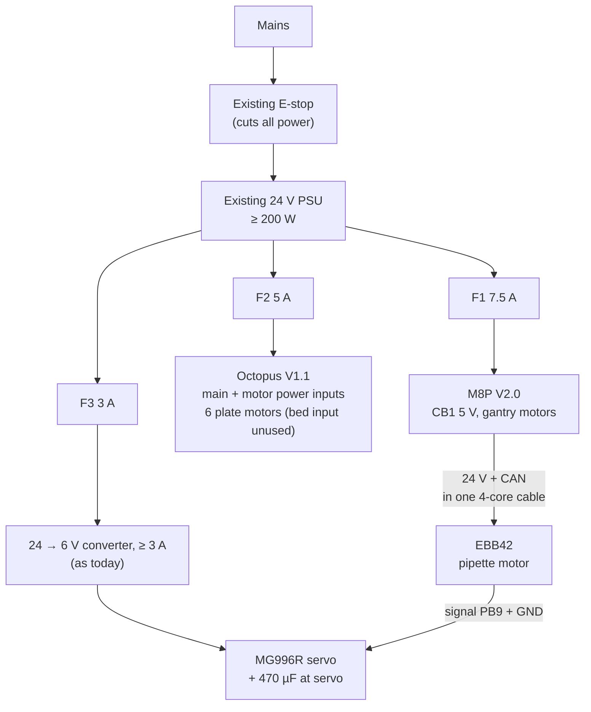
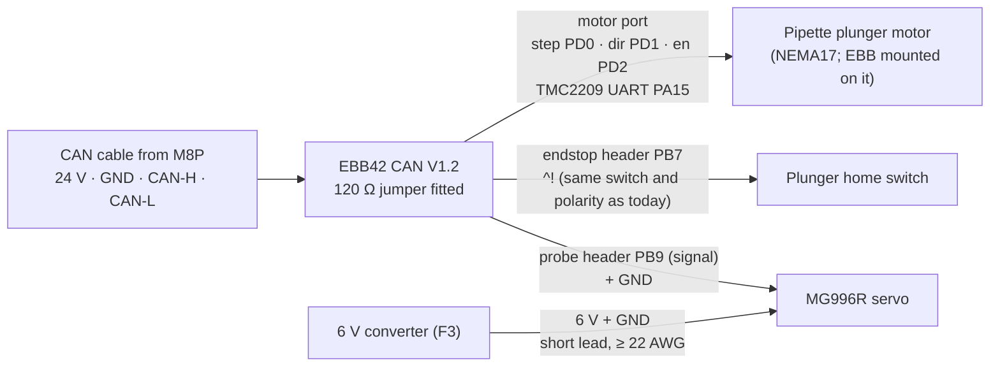
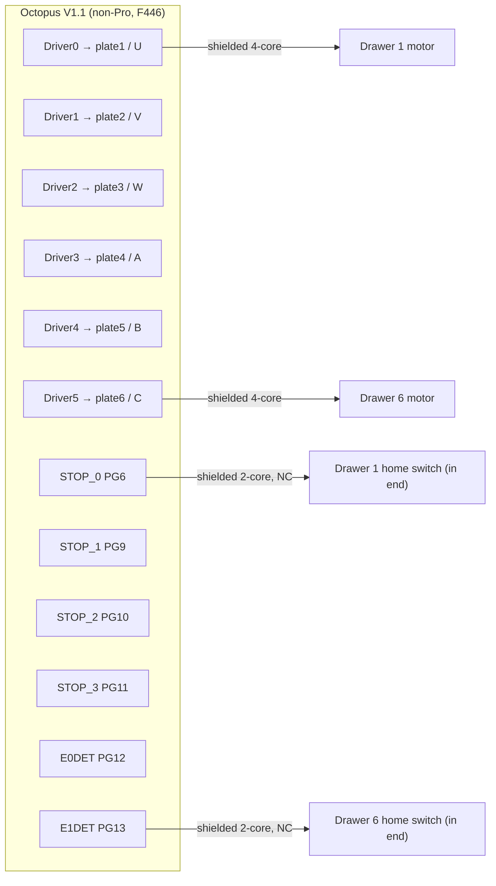
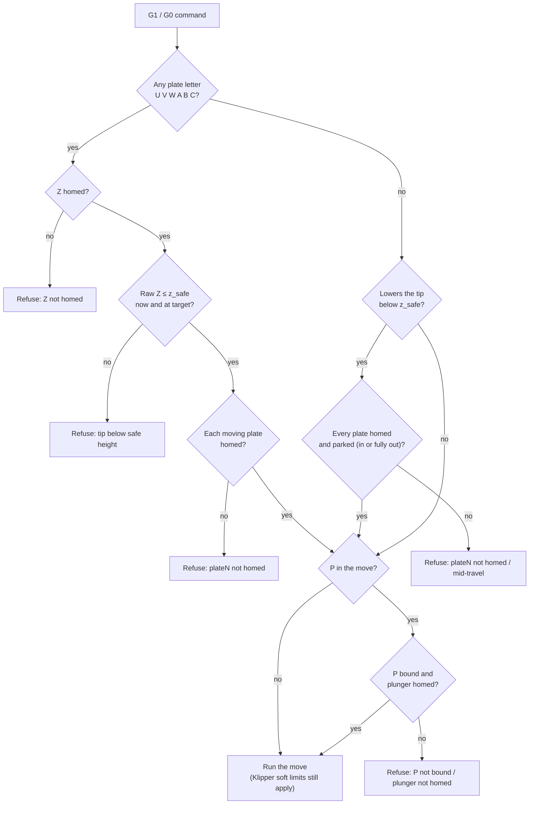
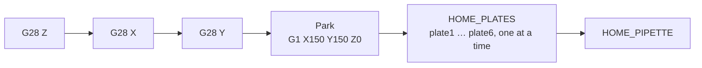
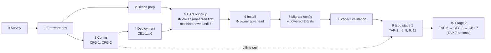
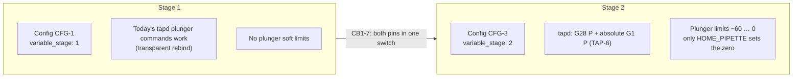

# Diagrams

| Field    | Value |
|----------|-------|
| Status   | Draft for review |
| Revision | L |
| Owner    | James |
| Project  | Tricca AutoPipette |
| Parent   | `00-umbrella-plan.md` |
| Date     | 2026-10-20 |

---

Mermaid diagrams. They render on GitHub and in most Markdown viewers. Where a diagram and a table disagree, **the table in the work package wins**; fix the diagram.

## 1. Controllers and data links

How the CB1 talks to each board. Only one CAN bus: M8P bridge ↔ EBB42.

## 2. Power and fuses

Everything sits downstream of the existing E-stop.

Typical load ≈ 100 W (≈ 115 W with a servo stall); PSU headroom ≥ 2×. Fuse wire gauges and expected currents: WP1 §4.

## 3. Pipette head wiring (EBB42)

The servo's power **never** comes from the EBB (its 5 V rail is 1 A total). The converter ground and the EBB ground are common.

## 4. Plate drawer wiring (Octopus V1.1, one per slot)

Drawers 2–5 follow the same pattern on the slots shown. Full pin table (step/dir/enable/UART): WP1 §3.1; driver 3's enable pin is PA0 on this board. Shields are grounded at the controller end only. Every DIAG jumper is removed; this board has no per-driver voltage jumpers.

## 5. Interlock decision for a `G1` / `G0` move

The first failing check is the one reported. The check reads **raw** positions, so G92 and offsets can't hide where the tip really is.

Commands that move Z **without** `G1` get the "lowers the tip" branch of this check before they run:
- `SET_GCODE_OFFSET … MOVE=1`, for example Mainsail's Z-offset buttons.
- `RESTORE_GCODE_STATE … MOVE=1`, and `RESUME` after a pause.
- `STEPPER_BUZZ` on a Z stepper.

`STEPPER_BUZZ` on a plate needs Z homed and the tip raised. `MANUAL_PROBE` and `Z_ENDSTOP_CALIBRATE` are refused outright. The full list is in umbrella §6.2, and the offline tests check it against every command Klipper registers.

## 6. What a bare `G28` does

`G28` with letters homes only what is named, in Z, X, Y order. If any gantry axis was named, it then parks the axes that are now homed (so `G28 X` on a cold machine moves only X). Next come the named plates, then `P`. Each plate's homing fails if its switch doesn't release after the first touch, so a broken wire can't fake a "home".

## 7. Phases

## 8. Rollout stages

## Revision History

| Rev | Date | Author | Change |
|-----|------|--------|--------|
| I | 2026-10-20 | James / Claude | New: topology, power, head and drawer wiring, interlock, `G28`, phases, stages |
| J | 2026-10-21 | James / Claude | Review fixes: non-G1 Z paths under the interlock diagram (offset claim corrected); plunger switch label (not NC); `G28` park and switch-release notes; phases and stages use CB1-7, `variable_stage`, TAP-7 optional |
| K | 2026-10-22 | James / Claude | Interlock notes: manual probe commands refused; command list is tested |
| L | 2026-10-22 | James / Claude | Octopus V1.1 (non-Pro, F446): topology, power and drawer wiring |
